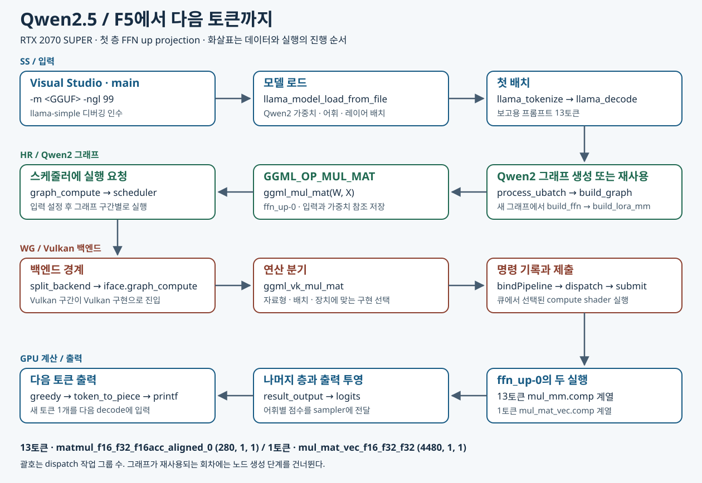

# Qwen2.5의 행렬곱을 GGUF에서 Vulkan까지 따라가기

2026년 11월 11일 팀 중간보고 · llama.cpp `e6ab7c1` · Windows Debug/x64 · RTX 2070 SUPER

세 사람 모두 같은 `llama-simple`을 실행한다. SS는 **모델 파일과 프롬프트 → 토큰 배치**, HR은 **토큰 배치와 모델 가중치 → GGML 행렬곱 노드**, WG는 **그 노드 → Vulkan 파이프라인과 dispatch**를 보여준다. 세 화면에서 이어 볼 대표 연산은 0번째 Transformer 블록의 FFN up projection이다. 가중치 이름은 `blk.0.ffn_up.weight`, 결과 노드 이름은 `ffn_up-0`이다.



**F5 한 번으로 이 경로가 실행되는 이유.** 최상위 `CMakeLists.txt`가 `llama-simple`을 시작 프로젝트로 지정하고 디버거에 모델 경로와 `-ngl 99`를 전달한다. 예제의 `examples/simple/CMakeLists.txt`가 `simple.cpp`로 실행 파일을 만들고 llama 라이브러리를 연결한다. `main`은 그 라이브러리의 모델 로더와 decode API를 호출한다. 이 빌드에는 Vulkan 백엔드가 포함돼 있다.

## 실습 파일과 용어

| 이름 | 이 실습에서 하는 일 | 직접 확인할 값 |
|---|---|---|
| GGUF | 모델을 저장하는 바이너리 파일 형식. 헤더에는 버전과 항목 수, 메타데이터에는 모델 구조·토크나이저 정보, 텐서 목록에는 이름·차원·자료형·위치가 있고 뒤에 가중치 데이터가 있다. | 실습 파일의 헤더는 GGUF v3, 메타데이터 26개, 텐서 339개다. 첫 층 FFN up 가중치의 자료형은 F16, 차원은 `[1536,8960]`이다. |
| GGML | 텐서와 연산을 표현하고 계산 그래프의 실행을 백엔드에 맡기는 라이브러리. | HR의 화면에서 `result->op`는 `GGML_OP_MUL_MAT`, `src[0]`과 `src[1]`은 가중치와 입력이다. |
| Vulkan | GPU에 계산 명령을 기록하고 제출하는 API. llama.cpp의 Vulkan 백엔드는 GGML 노드에 맞는 compute pipeline을 선택한다. | WG의 화면에서는 `pipeline->name`과 `wg0, wg1, wg2`로 실제 구현과 작업 그룹 수를 읽는다. |

[GGUF 공식 사양](https://github.com/ggml-org/ggml/blob/master/docs/gguf.md) · [GGML 프로젝트](https://github.com/ggml-org/ggml)

## 같은 프로그램 실행하기

**VS Code**에서 **파일 → 폴더 열기**로 `D:\llama-vulkan-lab`을 연다. 왼쪽 **실행 및 디버그**에서 `llama-simple | CPU` 또는 `llama-simple | Vulkan`을 선택하고 F5를 누른다. [두 실행 설정](.vscode/launch.json)은 같은 실행 파일·모델·프롬프트로 3토큰을 생성한다. CPU 설정은 `-ngl 0`, Vulkan 설정은 `-ngl 99`를 전달한다.

**Visual Studio 2022**를 쓰면 [솔루션 열기](00-open-visual-studio.cmd)를 실행하고 **Debug / x64**, 시작 프로젝트 **llama-simple**, F5 순으로 실행한다. 이 솔루션의 기존 F5 설정은 6토큰의 짧은 프롬프트를 사용한다. 아래 13토큰 실험과 맞추려면 **llama-simple 프로젝트 속성 → 구성 속성 → 디버깅 → 명령 인수**에 다음을 입력한다.

```text
-m "D:\llama-vulkan-lab\models\qwen2.5-1.5b-instruct-fp16.gguf" -ngl 99 -n 3 "The capital of South Korea is Seoul. The capital of France is"
```

**터미널에서 실행**하려면 다음 PowerShell 명령을 사용한다. 행렬곱을 포함한 추론이 실제로 수행되고, 성공하면 프롬프트 뒤에 생성된 텍스트가 출력된다.

```powershell
Set-Location D:\llama-vulkan-lab
.\build\bin\Debug\llama-simple.exe -m .\models\qwen2.5-1.5b-instruct-fp16.gguf -ngl 0 -n 3 "The capital of South Korea is Seoul. The capital of France is"
.\build\bin\Debug\llama-simple.exe -m .\models\qwen2.5-1.5b-instruct-fp16.gguf -ngl 99 -n 3 "The capital of South Korea is Seoul. The capital of France is"
```

실행 파일을 새로 만들 때는 [빌드](01-build.cmd)를 실행한다. 프로젝트는 Vulkan 백엔드를 포함하도록 `GGML_VULKAN=ON`으로 구성되어 있다. [빌드 설정](CMakeLists.txt)

## SS · 파일을 읽고 첫 토큰 배치를 전달한다

1. Visual Studio 2022에서 CPU 실행을 보려면 `llama-simple` 프로젝트 속성의 **디버깅 → 명령 인수**에서 `-ngl 0`을 지정한다. [simple.cpp](llama.cpp/examples/simple/simple.cpp)의 **89행**과 **173행**에 줄 번호 왼쪽을 눌러 중단점을 둔 뒤 F5로 실행한다. F9는 중단점 설정, F10은 현재 줄 실행, F11은 호출 안으로 들어가기, F5는 계속 실행이다.
2. **89행**에서 `model_path`와 `model_params.n_gpu_layers`를 확인한다. 앞의 87행에서 명령 인수 `-ngl`을 모델 로드 설정에 넣었다. F10으로 모델을 로드한 후 `model`을 확인한다. **104행**은 텍스트를 토큰 ID로 바꾸고, **119행**은 모델로 실행 문맥 `ctx`를 만든다.
3. **173행**에서 `batch.n_tokens`를 확인한다. 위 보고용 프롬프트는 처음에 **13**이다. `llama_decode(ctx, batch)`가 처리한 결과로 **182행**에서 다음 토큰을 선택하고 **190–196행**에서 문자로 바꾸어 출력한다. **200행**이 새 토큰 하나로 배치를 만들기 때문에 다음 173행에서는 **1**을 본다.

**보고 화면**에는 모델 파일명, `n_gpu_layers`, 첫 배치의 토큰 수를 같이 둔다. HR에게 넘기는 값은 `ctx`와 `batch`다.

**Visual Studio에서 173행을 세 번 보기.** 보고용 13토큰 프롬프트와 `-n 3`으로 실행하고 조사식에 `n_prompt`, `n_pos`, `batch.n_tokens`, `batch.token[0]`을 넣는다. `n_prompt`는 처음 계산한 입력 길이이므로 계속 13이다. `batch.n_tokens`는 이번에 평가할 길이여서 13 → 1 → 1로 바뀐다. 첫 배치는 149행에서 만들고, 다음 두 배치는 182행에서 고른 ID로 200행에서 만든다. 173행 진입 직전의 `n_pos`는 0 → 13 → 14다.

**SS에서 HR로 넘어가기.** 다시 실행해 173행에서 멈춘 상태에서 [llama-context.cpp](llama.cpp/src/llama-context.cpp) **1405행**에도 F9를 누른다. F5로 계속하면 현재 `llama_decode` 호출 안에서 그 줄에 멈춘다. **디버그 → 창 → 호출 스택**에서 `main`, `llama_decode`, `llama_context::decode`, `process_ubatch`가 이어지는 것을 확인한다.

## HR · FFN의 행렬곱 하나를 그래프에서 찾는다

1. **173행에서 멈춘 뒤** [llama-context.cpp](llama.cpp/src/llama-context.cpp) **1405행**을 활성화하고 계속 진행한다. `process_ubatch`는 이전 그래프의 재사용 조건을 검사한다. 새 그래프가 필요하면 **1425행**에서 `model.build_graph(gparams)`를 호출한다. 두 경로는 **1449행** 입력 설정, **1454행** 그래프 실행 요청에서 만난다. 먼저 173행까지 진행하면 초기화 중 메모리 예약용 그래프에 멈추는 일을 줄일 수 있다.
2. 새 그래프를 만드는 경로에서 [qwen2.cpp](llama.cpp/src/models/qwen2.cpp) **119행**에 조건 `il == 0`을 건다. Qwen2 블록이 정규화한 입력과 `model.layers[il].ffn_up`을 FFN에 넘긴다. [llama-graph.cpp](llama.cpp/src/llama-graph.cpp) **1786행**의 `build_lora_mm(up, cur)`, **1518행**의 `ggml_mul_mat(ctx0, w, cur)` 순서로 들어간다.
3. 이 호출에서 [ggml.c](llama.cpp/ggml/src/ggml.c) **3355행**까지 진행한다. 조사식에 `a->name`, `a->type`, `a->ne`, `b->type`, `b->ne`, `result->op`, `result->ne`를 추가한다. **3351–3353행**에서 결과에 연산 종류와 두 입력을 기록했다. 호출이 반환된 후 상위 함수의 **1787행**에서 FFN up 결과에 이름을 붙인다.

GGML의 `ne`는 가장 안쪽 차원을 먼저 적는다. 이 연산은 토큰마다 입력 특징 1,536개를 가중치와 곱해 더한 뒤 출력 특징 8,960개를 만든다. 아래는 앞의 두 차원이며 나머지 두 차원은 이 예에서 1이다.

| 첫 층 FFN up | 가중치 W · F16 | 입력 X · F32 | 결과 Y · F32 |
|---|---|---|---|
| 프롬프트 13토큰 | [1536, 8960] | [1536, 13] | [8960, 13] |
| 다음 토큰 1개 | [1536, 8960] | [1536, 1] | [8960, 1] |

**보고 화면**에는 `GGML_OP_MUL_MAT`과 입력·출력 차원을 둔다. WG에게 넘기는 것은 F16 가중치와 입력을 참조하는 이 노드다.

## WG · 같은 연산이 Vulkan에서 실행되는 근거를 잡는다

1. **Vulkan 프로필**로 다시 실행한다. `-ngl 99`는 GPU에 배치할 레이어 수의 요청값이다. 이 모델의 로드 로그는 CPU 설정에서 **0/29**, Vulkan 설정에서 **29/29**를 보고했다. Vulkan0의 모델 버퍼는 **2944.68 MiB**였다. [CPU 실행 기록](logs/run-CPU-Debug-20261111-101720.log) · [Vulkan 실행 기록](logs/report-vulkan-dispatch-20261111-101620.log)
2. [ggml-backend.cpp](llama.cpp/ggml/src/ggml-backend.cpp) **968행**에서 가중치 버퍼와 현재 연산을 기준으로 백엔드 후보를 구한다. **897행**의 지원 여부 검사와 **1799행**의 `split_backend`를 함께 보면 어느 백엔드로 그래프 구간이 넘어가는지 설명할 수 있다. 콜백이 켜진 경로에서는 **1821행**에서도 실행을 요청한다.
3. [ggml-vulkan.cpp](llama.cpp/ggml/src/ggml-vulkan/ggml-vulkan.cpp) **12392행**은 `MUL_MAT`을 Vulkan 행렬곱 함수로 보낸다. 실제 시연은 **6990행**에 중단점을 둔다. 이때 `dst`, `src0`, `src1`이 준비되어 있다. 조건 `dst->ne[0] == 8960 && src0->ne[0] == 1536`으로 범위를 줄이고, `dst->name`이 **ffn_up-0**인지 확인한다. 같은 크기의 `ffn_gate-0`에 먼저 멈추면 F5로 계속한다.
4. `dst->ne[1]`을 보고 **7048행**의 벡터 경로 또는 **7050행**의 일반 행렬곱 경로로 들어간다. 이 버전 일반 벡터 분기는 N=1과 배치 조건을 만족하는 일부 N≤8을 다룬다. 앞선 특수 분기, 자료형, 메모리 배치, 장치 특성도 구현 선택에 관여한다. 선택된 노드 안에서 [ggml-vulkan-common.h](llama.cpp/ggml/src/ggml-vulkan/ggml-vulkan-common.h) **279행**까지 진행해 `pipeline->name`과 `wg0, wg1, wg2`를 본다. **271행**에서 파이프라인을 바인딩하고, **279행**에서 GPU 명령 버퍼에 dispatch를 기록한다. 이어서 큐에 제출한다.

| RTX 2070 SUPER에서 관찰한 `ffn_up-0` | 파이프라인 이름 | dispatch 작업 그룹 수 (x, y, z) |
|---|---|---|
| 프롬프트 13토큰 | `matmul_f16_f32_f16acc_aligned_0` | (280, 1, 1) |
| 다음 토큰 1개 | `mul_mat_vec_f16_f32_f32` | (4480, 1, 1) |

실행 기록 **738–740행**과 **2415–2417행**에는 각각 노드 이름, 파이프라인 이름과 작업 그룹 수, `vkCmdDispatch`가 차례로 남았다. **2371행**과 **3643행**에서 K=1536, M=8960인 연산의 N을 대조할 수 있다. [Vulkan dispatch 기록](logs/report-vulkan-dispatch-20261111-101620.log)

셰이더 소스까지 보여주려면 [vulkan-shaders-gen.cpp](llama.cpp/ggml/src/ggml-vulkan/vulkan-shaders/vulkan-shaders-gen.cpp) **779–781행**에서 F16 가중치용 `mul_mat_vec_f16_f32_f32` 변형이 [mul_mat_vec.comp](llama.cpp/ggml/src/ggml-vulkan/vulkan-shaders/mul_mat_vec.comp)에서 생성되는 지점을 연다. 일반 matmul 셰이더 계열의 소스 선택은 같은 생성기 **502행**에 있다.

## 보고할 때 읽을 문장

“SS는 Qwen2.5 GGUF를 로드하고 13개 토큰을 decode에 넘겼습니다. HR은 첫 층 FFN에서 1,536개 입력 특징을 8,960개로 확장하는 GGML 행렬곱을 확인했습니다. WG는 이 노드를 RTX 2070 SUPER에서 추적했습니다. 같은 가중치를 써도 프롬프트 13토큰에서는 일반 행렬곱, 다음 토큰 1개에서는 행렬–벡터 파이프라인이 선택됐고 두 경우 모두 Vulkan dispatch가 기록됐습니다.”

코드를 발표 화면에서 찾아갈 때는 [Graphify 코드 지도](graphify-out/graph.html)에서 함수 이름을 검색한다. 실행 결과를 보여줄 때는 위 로그 또는 디버거 조사식을 연다.

## 코드 트리 · F5 한 번을 펼쳐 보기

들여쓰기는 호출 또는 그 단계에서 시작되는 작업을 뜻한다. GPU 작업은 명령 버퍼와 큐를 거치므로 셰이더와 C++ 함수 사이에는 비동기 실행 경계가 있다. 줄 번호는 위 고정 커밋 기준이다.

```text
main                                               simple.cpp:14
├─ ggml_backend_load_all                           :82   장치와 백엔드 등록
├─ llama_model_load_from_file                      :89   -m의 모델 파일 열기
│  ├─ llama_model_loader → gguf_init_from_file            GGUF 텐서 목록과 메타데이터 읽기
│  ├─ llama_model_create → llama_model_qwen2              모델 구현 선택
│  └─ load_tensors → ml.load_all_data                    레이어별 버퍼에 가중치 준비
├─ llama_tokenize → llama_init_from_model                 프롬프트 ID와 실행 문맥 준비
├─ llama_batch_get_one                            :149   첫 배치에 프롬프트 전체 넣기
└─ 생성 루프
   ├─ llama_decode                                :173
   │  └─ ctx->decode → process_ubatch                     배치를 실행 단위로 처리
   │     ├─ 새 그래프가 필요할 때 model.build_graph
   │     │  └─ build_arch_graph → Qwen2 graph
   │     │     ├─ 임베딩 → 블록별 attention → FFN
   │     │     │  └─ build_ffn → build_lora_mm → ggml_mul_mat
   │     │     └─ 출력 투영 → t_logits → ggml_build_forward_expand
   │     └─ 입력 설정 → graph_compute → GGML scheduler
   │        └─ Vulkan에 배정된 split → backend->iface.graph_compute
   │           └─ ggml_backend_vk_graph_compute → ggml_vk_build_graph
   │              ├─ GGML_OP_MUL_MAT → ggml_vk_mul_mat → pipeline 선택
   │              └─ bindPipeline → dispatch 기록 → 큐에 submit
   │                 └─ GPU 셰이더가 곱·누산·저장 → 후속 노드가 사용
   ├─ 마지막 출력 행의 logits → llama_sampler_sample     :182   greedy로 토큰 ID 선택
   ├─ llama_token_to_piece → printf                      :190,196   새 텍스트 출력
   └─ llama_batch_get_one(&new_token_id, 1)               :200   다음 반복의 입력
```

### 코드와 설명 · 디버거에서 놓치기 쉬운 연결부

아래 코드 열은 해당 줄의 핵심 발췌다. 파일 경로의 시작은 `llama.cpp/`다.

| 실제 코드 | 그 줄을 실행하면 일어나는 일 |
|---|---|
| `model_params.n_gpu_layers = ngl;` · `examples/simple/simple.cpp:87` | F5가 건넨 GPU 레이어 요청을 로더 설정에 넣는다. 모델 파일명은 같은 함수가 `-m`에서 읽는다. |
| `metadata_ptr.reset(gguf_init_from_file(fname.c_str(), params));` · `src/llama-model-loader.cpp:570` | 파일에서 GGUF 정보를 읽는다. `src/llama.cpp:319`에서 만든 로더를 사용해 모델 종류와 차원을 해석한다. |
| `return new llama_model_qwen2(params);` · `src/llama-model.cpp:98` | 이번 Qwen2.5 모델의 아키텍처 키는 qwen2다. 해당 C++ 구현이 0번째 층의 `layer.ffn_up`과 GGUF의 가중치를 연결한다. `src/models/qwen2.cpp:45` 참조. |
| `pimpl->dev_layer[il] = get_layer_buft_list(il);` · `src/llama-model.cpp:1542` | 레이어의 장치와 버퍼 후보를 정한다. `ml.load_all_data(...)`를 호출하는 1871행에서 버퍼와 파일 데이터가 연결된다. |
| `const int ret = ctx->decode(batch);` · `src/llama-context.cpp:4329` | 공개 API에서 문맥의 decode 구현으로 진입한다. 1887행에서 현재 마이크로배치를 `process_ubatch`에 넘긴다. |
| `std::make_unique<graph>(*this, params)` · `src/models/qwen2.cpp:50` | 1425행의 그래프 생성 요청(`llama-context.cpp`)이 모델의 가상 함수로 이어진다. Qwen2 그래프 생성자는 토큰 임베딩부터 최종 출력까지 연결한다. |
| `ggml_mul_mat(ctx0, w, cur)` · `src/llama-graph.cpp:1518` | FFN up의 W와 입력 X로 결과 노드를 만든다. `ggml/src/ggml.c:3351–3353`에서 `result->op = GGML_OP_MUL_MAT`, `src[0] = a`, `src[1] = b`를 기록한다. 계산할 한 원소는 `Y[m,t] = Σₖ W[m,k] × X[t,k]`다. |
| `ggml_backend_graph_compute_async(split_backend, &split->graph)` · `ggml/src/ggml-backend.cpp:1799` | 스케줄러가 선택한 백엔드에 그래프 구간을 전달한다. 463행의 `backend->iface.graph_compute(backend, cgraph)`가 실제 구현을 호출한다. Vulkan 함수 포인터 등록은 `ggml-vulkan.cpp:14833`이다. |
| `ggml_vk_build_graph(...)` · `ggml-vulkan.cpp:14294` | Vulkan 구간의 노드를 명령으로 변환한다. 12392행에서 MUL_MAT을 처리한 뒤 7048행 또는 7050행이 각각 벡터용 또는 일반 행렬곱 구현으로 보낸다. |
| `buf.dispatch(wg0, wg1, wg2);` · `ggml-vulkan-common.h:279` | 셰이더, 입력·출력 버퍼, 작업 그룹 수가 정해진 명령을 기록한다. `ggml-vulkan.cpp:946`의 `handle->submit(submit_infos, fence)`를 거쳐 장치 큐에 제출된다. |
| `res->t_logits = cur;` · `src/models/qwen2.cpp:151` | FFN up은 중간 결과다. gate와 down, 잔차 연결, 나머지 블록과 최종 정규화를 거친 뒤 145행의 출력 투영이 어휘별 점수를 만든다. 153행은 이 결과에 필요한 노드를 그래프에 포함한다. |
| `ggml_backend_tensor_get_async(backend_res, t_logits, logits_out, ...)` · `src/llama-context.cpp:1944` | decode가 샘플링에 필요한 출력 행을 호스트 버퍼로 읽도록 요청한다. `simple.cpp:132`에서 설정한 greedy sampler가 182행에서 마지막 행을 이용한다. 종료 토큰이면 루프를 끝내고, 그 외에는 196행에서 새 문자열을 쓴다. 144행의 출력은 입력 프롬프트를 다시 보여주는 부분이다. |

### 셰이더에서 숫자가 만들어지는 줄

셰이더 폴더는 `ggml/src/ggml-vulkan/vulkan-shaders/`다. 빌드 시 GLSL 변형을 SPIR-V로 컴파일하고, 실행 시 백엔드가 장치와 입력에 맞는 변형의 compute pipeline을 바인딩한다.

| GLSL 또는 생성기 | 계산 |
|---|---|
| `mul_mm.comp:210`의 `main()` | 프롬프트의 일반 행렬곱 경로다. 가중치와 여러 토큰의 입력을 타일로 읽고 K축을 따라 누산한다. 같은 소스에서 컴파일 옵션에 따라 400행의 `coopMatMulAdd(...)` 또는 434–435행의 `dot_product(...)` 같은 구현을 생성한다. dispatch 로그로 확인한 값은 위의 파이프라인 이름과 작업 그룹 수다. |
| `mul_mat_vec.comp:248`의 `main()` → `compute_outputs(...)` | 한 토큰 경로에서는 작업 그룹 ID로 담당할 출력 행을 정한다. 정렬된 F16 입력 가중치를 처리하는 코드의 135행은 `temp[j][n] += dot(v, b);`로 가중치 조각과 입력 조각의 내적을 더한다. |
| `mul_mat_vec.comp:245`의 `reduce_result(...)` | 여러 스레드의 부분합을 합쳐 출력 버퍼에 쓴다. 구현은 `mul_mat_vec_base.glsl:94` 이후다. 첫 층의 결과는 토큰당 실수 8,960개이며 다음 FFN 연산의 입력이 된다. |

## Qwen 없이 행렬곱 한 개만 실행하기

[독립 예제 소스](matmul-demo/main.cpp)는 같은 Debug 빌드의 GGML을 사용한다. 두 출력 특징의 가중치는 각각 `[1,2,3]`, `[4,5,6]`이고, 두 토큰의 입력은 `[1,0,1]`, `[0,1,0]`이다. 첫 토큰의 두 번째 출력은 `4×1 + 5×0 + 6×1 = 10`이다.

```powershell
Set-Location D:\llama-vulkan-lab
$env:PATH = "$PWD\build\bin\Debug;$env:PATH"
.\build\matmul-demo\Debug\matmul-demo.exe CPU
.\build\matmul-demo\Debug\matmul-demo.exe Vulkan0
```

이 PC에서 두 명령 모두 종료 코드 0, 출력은 각각 `CPU: token 0 [4, 10], token 1 [2, 5]`, `Vulkan0: token 0 [4, 10], token 1 [2, 5]`였다.

| 예제 코드 순서 | CPU → Vulkan에서 확인할 점 |
|---|---|
| `ggml_backend_init_by_name(argv[1], nullptr)` | 인수를 CPU에서 Vulkan0으로 바꾸면 실행 장치가 바뀐다. |
| `ggml_mul_mat(ctx, w, x)` → `ggml_build_forward_expand(graph, y)` | 두 실행이 같은 수식과 그래프를 구성한다. |
| `ggml_backend_alloc_ctx_tensors(ctx, backend)` → `ggml_backend_tensor_set(...)` | 선택한 장치에 텐서 버퍼를 만들고 W와 X를 채운다. |
| `ggml_backend_graph_compute(backend, graph)` → `ggml_backend_tensor_get(...)` | 그 장치에서 계산한 Y를 읽고 손계산한 네 값과 대조한다. Qwen 전체 추론에서는 스케줄러가 여러 구간의 배정을 담당한다. |

예제 소스를 수정했다면 실습 폴더에서 다음 명령으로 다시 빌드한다. 기존 llama-simple Debug 빌드의 헤더·라이브러리를 사용한다.

```powershell
cmake -S matmul-demo -B build/matmul-demo -G "Visual Studio 17 2022" -A x64
cmake --build build/matmul-demo --config Debug
```
